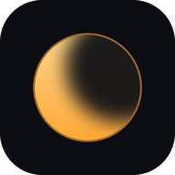

# Penumbra

**Autor / Author:** Hunys with Claude AI · **Licență / License:** MIT (open source) · **v1.0**

---

## 🇷🇴 Română

Penumbra întunecă ecranul telefonului **mai mult decât luminozitatea minimă**. E bună noaptea, în întuneric, când și cea mai mică luminozitate tot te orbește.

### Ce face
- **Întunecare** de la 0 la 80% (până la 90% cu „Acoperire completă”), cu glisor, butoane − / + și nivele rapide 30 / 50 / 70 / maxim.
- **Filtru cald**: un strat chihlimbariu care taie lumina albastră, mai ușor pentru ochi seara.
- **Lumină de fundal minimă**: cât timp Penumbra e pornit, lumina ecranului coboară la minimul telefonului. Când îl oprești, revine cum era.
- **Acoperire completă** (opțional): întunecă și bara de sus, bara de jos și panoul de notificări. Folosește un serviciu de accesibilitate care doar desenează stratul. Nu citește ecranul, atingerile sau ce scrii.
- **Notificare cu butoane**: −10%, +10% și Oprește, fără să deschizi aplicația.
- **Buton rapid** „Penumbra” în panoul de sus.
- Pornește singur după repornirea telefonului, dacă era pornit.
- Atingerile trec prin strat, deci folosești telefonul normal.
- Interfață în **română și engleză**. Merge și cu telecomanda (D-pad) pe proiectoare sau televizoare cu Android.
- Android 5.0 sau mai nou. Fără reclame și fără internet.

### De ce maxim 80%?
Din Android 12, sistemul nu lasă atingerile să treacă printr-un strat al altei aplicații mai opac de 80%. Peste această limită n-ai mai putea apăsa nimic pe ecran. Pentru mai întunecat, pornește „Lumină de fundal minimă”, sau „Acoperire completă”, care urcă limita la 90%.

### Instalare
1. Descarcă `Penumbra-v1.0.apk` de la [Releases](https://github.com/cosminpaulet41-beep/Hunys-with-Claude-AI/releases) și deschide-l. Dacă telefonul îți cere, permite instalarea din surse necunoscute.
2. Deschide Penumbra și apasă **OPRIT — atinge ca să pornești**. Telefonul te duce la „Afișare peste alte aplicații”. Pornește permisiunea pentru Penumbra și revino în aplicație.
3. Pe **Huawei** (EMUI): Setări › Baterie › Lansare aplicații › Penumbra › gestionare manuală, cu toate cele trei opțiuni pornite. Altfel sistemul o poate opri în fundal.

**Acoperire completă:** apasă butonul din aplicație, apoi în Accesibilitate pornește „Penumbra” (uneori e la „Aplicații descărcate” sau „Servicii instalate”). Android îți arată un avertisment general pentru serviciile de accesibilitate. Penumbra nu cere acces la conținutul ferestrelor. Pe Android 13+, dacă „Penumbra” e gri: Setări › Aplicații › Penumbra › ⋮ › Permite setări restricționate.

Pentru Bluetooth: Android nu trimite fișiere .apk, așa că trimite `Penumbra-v1.0-bluetooth.zip`, apoi extrage-l pe celălalt telefon.

### Compilare
Vezi `build.sh`. Nu are nevoie de Android Studio sau Gradle. Folosește aapt2, javac, dx, uber-apk-signer și android.jar API 34. Iconițele se fac cu `tools/make_icons.py` (Python + Pillow).
Cheia de semnare (`keystore/penumbra.keystore`, parola `penumbra`) e inclusă, ca versiunile noi să se instaleze peste cea veche.

---

## 🇬🇧 English

Penumbra dims your phone's screen **below the lowest brightness setting**. It's for night use in the dark, when even minimum brightness is too bright.

### What it does
- **Dimming** from 0 to 80% (up to 90% with "Full cover"), with a slider, − / + buttons and quick levels 30 / 50 / 70 / max.
- **Warm filter**: an amber layer that cuts blue light and is easier on the eyes at night.
- **Minimum backlight**: while Penumbra is on, the screen's backlight drops to the phone's minimum. It goes back when you turn Penumbra off.
- **Full cover** (optional): also dims the top bar, the bottom bar and the notification panel. It uses an accessibility service that only draws the layer. It doesn't read the screen, your taps or what you type.
- **Notification with buttons**: −10%, +10% and Turn off, without opening the app.
- **Quick Settings tile** "Penumbra".
- Turns itself back on after a reboot if it was on.
- Touches pass through the layer, so you use the phone as usual.
- Interface in **Romanian and English**. Also works with a remote (D-pad) on Android projectors and TVs.
- Android 5.0 or newer. No ads, no internet.

### Why 80% max?
Since Android 12, the system won't let touches pass through another app's layer that is more than 80% opaque. Past that limit you couldn't tap anything on screen. For darker, turn on "Minimum backlight", or "Full cover", which raises the limit to 90%.

### Install
1. Download `Penumbra-v1.0.apk` from [Releases](https://github.com/cosminpaulet41-beep/Hunys-with-Claude-AI/releases) and open it. Allow installs from unknown sources if your phone asks.
2. Open Penumbra and tap **OFF — tap to turn on**. The phone takes you to "Display over other apps". Turn the permission on for Penumbra and come back to the app.
3. On **Huawei** (EMUI): Settings › Battery › App launch › Penumbra › manage manually, with all three options on. Otherwise the system may stop it in the background.

**Full cover:** tap the button in the app, then turn on "Penumbra" in Accessibility (sometimes under "Downloaded apps" or "Installed services"). Android shows a general warning for accessibility services. Penumbra doesn't ask for access to window content. On Android 13+, if "Penumbra" is greyed out: Settings › Apps › Penumbra › ⋮ › Allow restricted settings.

For Bluetooth: Android won't send .apk files, so send `Penumbra-v1.0-bluetooth.zip` and extract it on the other phone.

### Build
See `build.sh`. No Android Studio or Gradle needed. It uses aapt2, javac, dx, uber-apk-signer and an API 34 android.jar. Icons are made with `tools/make_icons.py` (Python + Pillow).
The signing key (`keystore/penumbra.keystore`, password `penumbra`) is included so new versions install over the old one.
