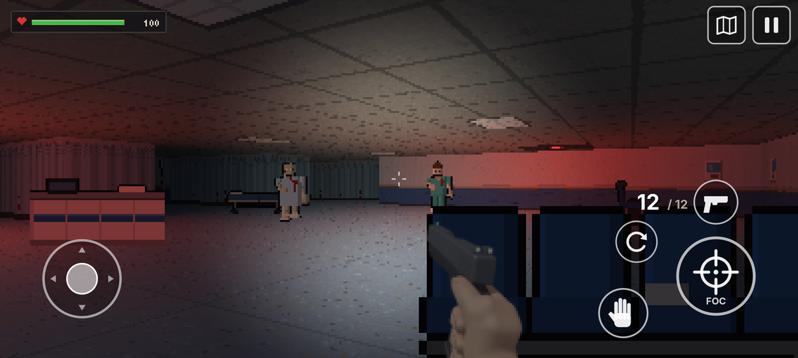
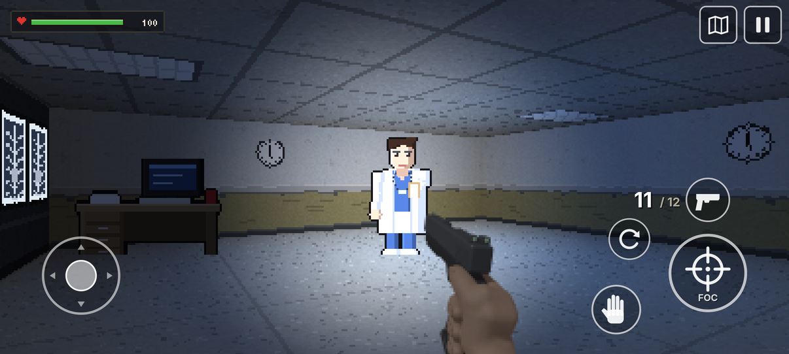
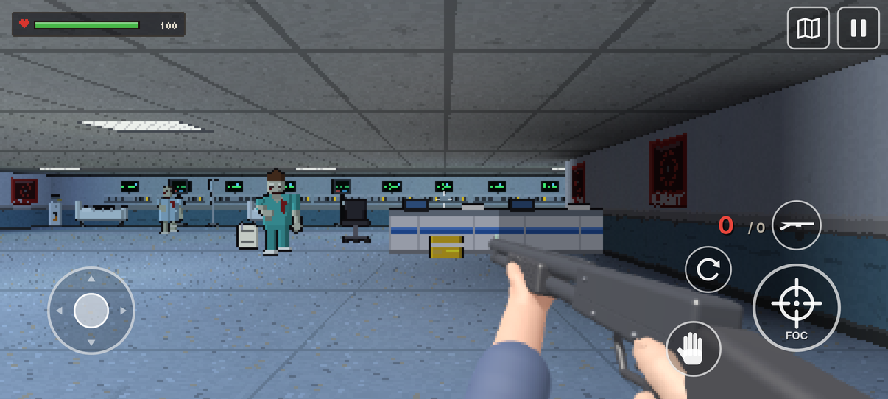
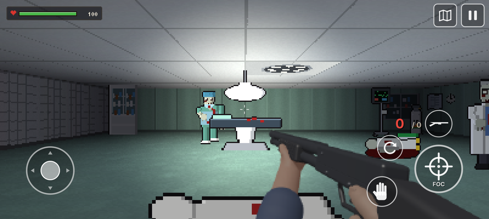
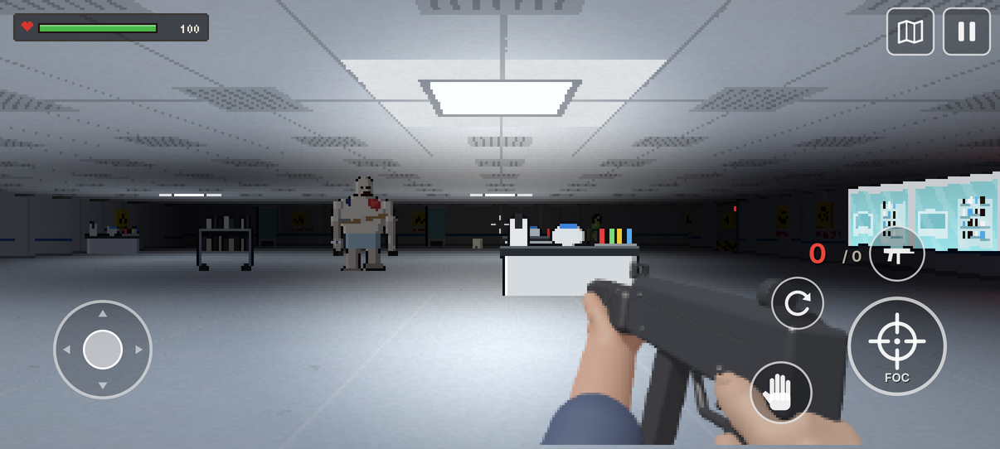
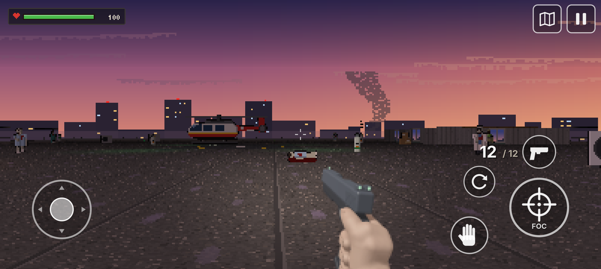
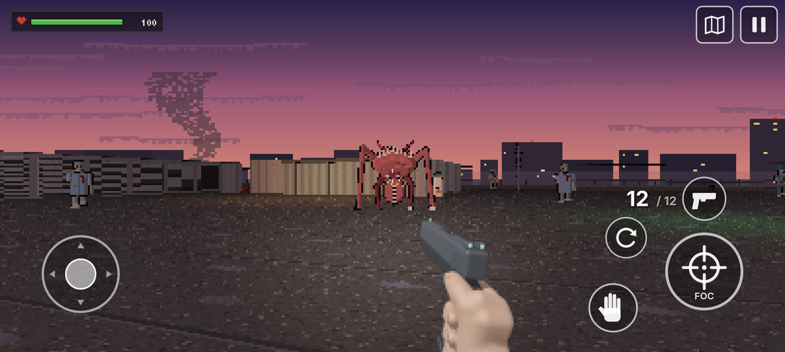

# Tura de Noapte 2 · Night Shift 2

**Autor / Author:** Hunys with Claude AI · Licență / License: [MIT](LICENSE)

## Română

Continuarea jocului de groază **Tura de Noapte** (Nokia E72), de data asta pentru Android, cu comenzi pe ecran.
După fabrica Vectra Bio, Andrei și Ioana ajung în zori în București. Lotul VN-9 a apucat să plece: la ora 6:00 începe
„vaccinarea” la **Spitalul Universitar**. Ioana o sună pe Elena, prietena ei de la Urgențe, și apelul se termină cu un țipăt.
Armata închide ieșirile din oraș, iar singurul elicopter SMURD care mai poate pleca stă pe acoperișul spitalului.

**Toată povestea, în trei episoade:**
1. **Parterul** - rampa ambulanțelor, Urgențele, radiologia, farmacia, capela, holul mare, cafeneaua, vestiarele și camera tehnică cu generatorul.
2. **Etajele** - ATI, blocul operator, pediatria (evacuată la timp) și laboratorul ascuns al firmei Vectra, unde te așteaptă Subiectul 9.
3. **Acoperișul** - etajul tehnic, liftul de serviciu, heliportul în zori și ce a ieșit din cutia cu probe.

Joci cu pistolul, pușca cu pompă și pistolul-mitralieră. Buteliile de oxigen explodează dacă tragi în ele.
Jocul se salvează singur la începutul fiecărui episod și oricând din pauză; episoadele terminate se pot rejuca din meniul **Episoade**.

**Cum arată:** lumea e desenată la rezoluție mică (pixeli mari, clari, fără blur), cu lumini colorate: avarie roșie,
neon rece pe circuitul de urgență, lumânări, monitoare și zorii prin geamuri; pe acoperiș se vede cerul și orașul în fum.
Mâinile cu armele sunt randate dintr-un model 3D. Butoanele și textele rămân netede, la rezoluția ecranului.
Din **Setări** se alege cât de mari sunt pixelii (fini, medii, retro) și **luminozitatea** (de la foarte întunecat la foarte luminos),
plus dificultatea, sensibilitatea, sunetul, vibrațiile și limba (română / engleză).

**Comenzi:** joystick în stânga jos (mers și pas lateral), tragi cu degetul în dreapta ca să te rotești, FOC (ținut apăsat
la pistolul-mitralieră), mâna (uși, vorbit, panouri), reîncărcare, schimbarea armei, hartă și pauză (salvare).

**Instalare:** descarcă APK-ul din [Releases](../../releases) (`TuraDeNoapte2-v….apk`) și deschide-l pe telefon
(permite instalarea din surse necunoscute, dacă îți cere). Ca să-l trimiți prin Bluetooth, folosește fișierul `-bluetooth.zip`.

**Cod:**
- `src/` nucleul jocului, fără Android: lumea și randarea (`World`), interfața (`Game`), textele în română și engleză (`Texts`).
- `android/` aplicația: ecranul de joc (`GameView`), sunetele, salvările și vibrațiile (`AndroidPlatform`).
- `desktop/` și `test/`: capturi de ecran exact ca pe telefon (`Shots`), un test care joacă la întâmplare (`Smoke`)
  și un jucător automat care termină toate cele trei episoade (`Play`).
- `tools/`: texturile, personajele, decorul și hărțile sunt generate din cod (`tex_spital.py`, `sprites_spital.py`,
  `mapgen_spital.py`); mâinile cu armele sunt randate 3D (`render_gun.py`); fonturile pixelate se transformă cu `FontGen.java`.
- `./gen_assets.sh` refă resursele din `assets/`; `./build.sh` face APK-ul fără Android Studio (vezi comentariile din script).

**Fonturi:** [Jersey 10](https://github.com/scfried/soft-type-jersey) și [Tiny5](https://github.com/Gissio/font_tiny5),
sub licența SIL Open Font License (`fonts/OFL-*.txt`).

## English

The sequel to the horror game **Night Shift** (Nokia E72), this time for Android, with on-screen controls.
After the Vectra Bio factory, Andrei and Ioana reach Bucharest at dawn. Batch VN-9 got away: at 6:00 the "vaccination"
starts at the **University Hospital**. Ioana calls Elena, her friend in the ER, and the call ends in a scream.
The army is sealing the city, and the only air ambulance helicopter that can still leave sits on the hospital roof.

**The whole story, in three episodes:**
1. **Ground Floor** - the ambulance bay, the ER, radiology, the pharmacy, the chapel, the main hall, the cafe, the locker rooms and the technical room with the generator.
2. **The Wards** - the ICU, the operating theatre, paediatrics (evacuated in time) and Vectra's hidden lab, where Subject 9 is waiting.
3. **The Roof** - the service floor, the service lift, the helipad at dawn and whatever came out of the sample box.

You play with a pistol, a pump shotgun and a submachine gun. Oxygen cylinders explode if you shoot them.
The game saves itself at the start of every episode and any time from the pause menu; finished episodes can be replayed from **Episodes**.

**Look:** the world is drawn at a low resolution (big, sharp pixels, no blur), with colored lights: red emergency lights,
cold neon on the emergency circuit, candles, monitors and dawn through the windows; on the roof you see the sky and the city in smoke.
The hands with the weapons are rendered from a 3D model. Buttons and text stay smooth, at the screen's resolution.
In **Settings** you choose the pixel size (fine, medium, retro) and the **brightness** (from very dark to very bright),
plus difficulty, sensitivity, sound, vibration and language (Romanian / English).

**Controls:** joystick at the bottom left (walk and strafe), drag on the right side to turn, FIRE (hold it with the
submachine gun), hand (doors, talk, panels), reload, switch weapon, map and pause (save).

**Install:** download the APK from [Releases](../../releases) (`TuraDeNoapte2-v….apk`) and open it on your phone
(allow installs from unknown sources if asked). To send it by Bluetooth, use the `-bluetooth.zip` file.

**Code:**
- `src/` the game core, without Android: the world and rendering (`World`), the interface (`Game`), texts in Romanian and English (`Texts`).
- `android/` the app: the game screen (`GameView`), sounds, saves and vibration (`AndroidPlatform`).
- `desktop/` and `test/`: screenshots exactly as on the phone (`Shots`), a test that plays at random (`Smoke`)
  and an automatic player that finishes all three episodes (`Play`).
- `tools/`: textures, characters, props and maps are generated from code (`tex_spital.py`, `sprites_spital.py`,
  `mapgen_spital.py`); the hands with the weapons are rendered in 3D (`render_gun.py`); pixel fonts are converted with `FontGen.java`.
- `./gen_assets.sh` rebuilds the resources in `assets/`; `./build.sh` makes the APK without Android Studio (see the comments in the script).

**Fonts:** [Jersey 10](https://github.com/scfried/soft-type-jersey) and [Tiny5](https://github.com/Gissio/font_tiny5),
under the SIL Open Font License (`fonts/OFL-*.txt`).
