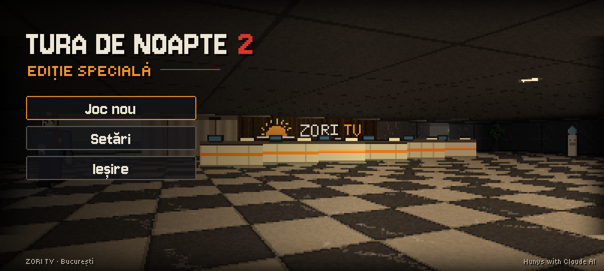
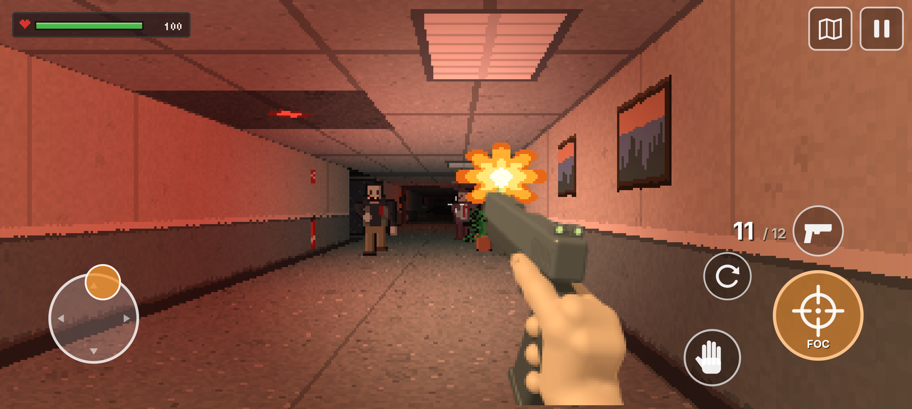
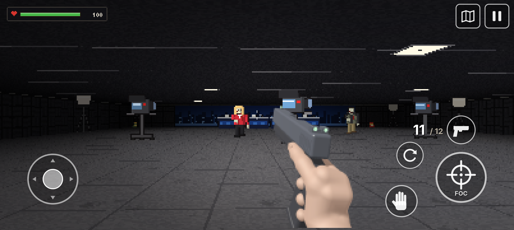
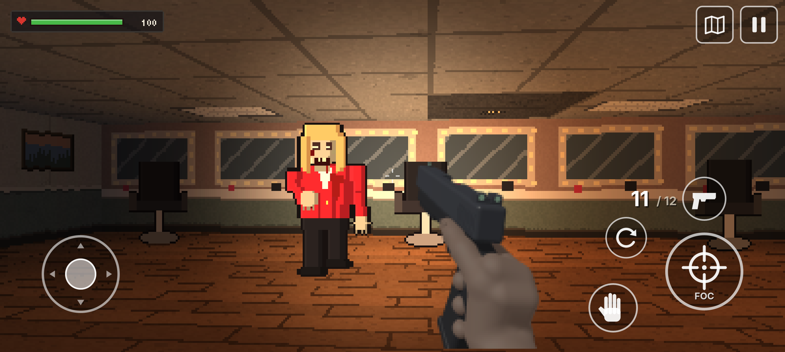
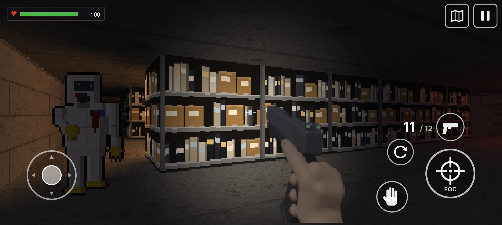
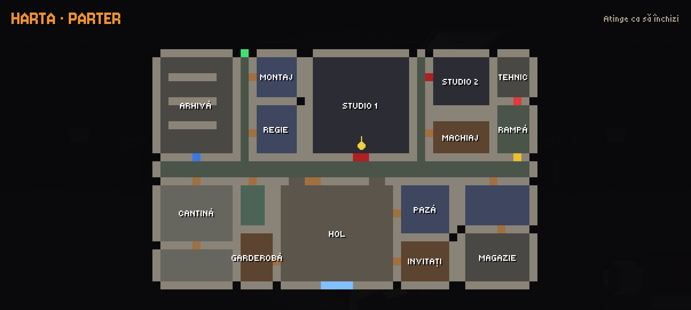

# Tura de Noapte 2 · Night Shift 2

**Autor / Author:** Hunys with Claude AI · Licență / License: [MIT](LICENSE)

## Română

Continuarea jocului de groază **Tura de Noapte** (Nokia E72), de data asta pentru Android, cu comenzi pe ecran.
După fabrica Vectra Bio, Andrei și Ioana ajung în zori în București, la televiziunea ZORI TV, ca să arate probele în direct.
Vectra a ajuns acolo înaintea lor: curentul e tăiat, ușile s-au blocat, iar tura de noapte s-a „vaccinat”.

**Stare: în lucru.** Sunt gata motorul 3D, parterul clădirii, personajele, interfața și comenzile. Urmează ajustările
cerute la capturi, apoi APK-ul pentru telefon.

**Cum arată:** lumea e desenată la rezoluție mică (pixeli mari, clari, fără blur), cu lumini colorate: avarie roșie,
monitoare, zorii prin geamuri și lanterna. Se poate alege cât de mari sunt pixelii (fini, medii, retro). Mâna cu pistolul
e randată dintr-un model 3D. Butoanele și textele rămân netede, la rezoluția ecranului.

**Parterul ZORI TV** (48 x 30 celule, 17 camere): holul cu sigla, paza (unde rămâne Ioana), două studiouri, regia,
camera de montaj, arhiva, machiajul, garderoba, cantina cu bucătăria, toaletele, biroul directorului, magazia,
camera tehnică cu generatorul și rampa de încărcare.

**Comenzi:** joystick în stânga jos (mers și pas lateral), tragi cu degetul în dreapta ca să te rotești, FOC (ținut apăsat
la pistolul-mitralieră), mâna (uși, vorbit, folosit), reîncărcare, schimbare armă, hartă și pauză (salvare).

**Cod:**
- `src/` nucleul jocului, fără Android: lumea și randarea (`World`), interfața (`Game`), textele în română și engleză (`Texts`).
- `desktop/` și `test/`: capturi de ecran exact ca pe telefon și un test care joacă singur câteva minute.
- `tools/`: texturile, personajele, decorul și harta sunt generate din cod (`textures.py`, `sprites.py`, `mapgen.py`);
  mâna cu pistolul e randată 3D (`render_gun.py`); fonturile pixelate se transformă cu `FontGen.java`.
- `./gen_assets.sh` refă resursele din `assets/`.

**Fonturi:** [Jersey 10](https://github.com/scfried/soft-type-jersey) și [Tiny5](https://github.com/Gissio/font_tiny5),
sub licența SIL Open Font License (`fonts/OFL-*.txt`).

## English

The sequel to the horror game **Night Shift** (Nokia E72), this time for Android, with on-screen controls.
After the Vectra Bio factory, Andrei and Ioana reach Bucharest at dawn, at the ZORI TV station, to show the samples live.
Vectra got there first: the power is cut, the doors are locked and the night shift has been "vaccinated".

**Status: work in progress.** The 3D engine, the ground floor, the characters, the interface and the controls are done.
Next come the changes asked for after the screenshots, then the APK for the phone.

**Look:** the world is drawn at a low resolution (big, sharp pixels, no blur), with colored lights: red emergency lights,
monitors, dawn through the windows and the flashlight. The pixel size can be chosen (fine, medium, retro). The hand with
the pistol is rendered from a 3D model. Buttons and text stay smooth, at the screen's resolution.

**ZORI TV ground floor** (48 x 30 cells, 17 rooms): the lobby with the logo, security (where Ioana stays), two studios,
the control room, the editing room, the archive, makeup, wardrobe, the cafeteria with the kitchen, restrooms,
the director's office, the storeroom, the technical room with the generator and the loading dock.

**Controls:** joystick at the bottom left (walk and strafe), drag on the right side to turn, FIRE (hold it with the
submachine gun), hand (doors, talk, use), reload, switch weapon, map and pause (save).

**Code:**
- `src/` the game core, without Android: the world and rendering (`World`), the interface (`Game`), texts in Romanian and English (`Texts`).
- `desktop/` and `test/`: screenshots exactly as on the phone and a test that plays by itself for a few minutes.
- `tools/`: textures, characters, props and the map are generated from code (`textures.py`, `sprites.py`, `mapgen.py`);
  the hand with the pistol is rendered in 3D (`render_gun.py`); the pixel fonts are converted with `FontGen.java`.
- `./gen_assets.sh` rebuilds the resources in `assets/`.

**Fonts:** [Jersey 10](https://github.com/scfried/soft-type-jersey) and [Tiny5](https://github.com/Gissio/font_tiny5),
under the SIL Open Font License (`fonts/OFL-*.txt`).
