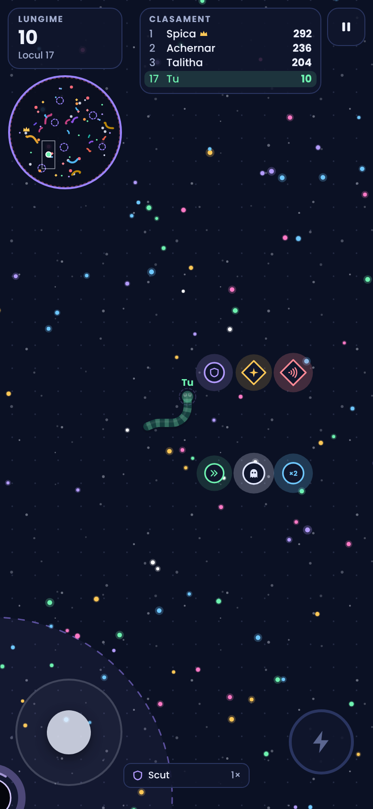
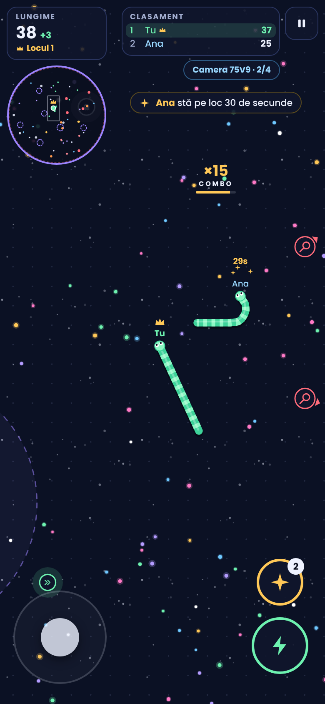

# Viermele Stelar · Star Worm

**Autor / Author:** Hunys with Claude AI · Licență / License: [MIT](../LICENSE)

## Română

Un joc cu viermi în spațiu, pentru telefon și calculator. Mănânci scântei ca să crești (cele mari valorează triplu), îi muști pe cei mai mici decât tine, aduni scuturi și arme, porți coroana când ești pe primul loc și eviți meteoriții, găurile negre și marginea arenei.

**Aplicația Android:** descarcă `ViermeleStelar.apk` de la [Releases](https://github.com/cosminpaulet41-beep/Hunys-with-Claude-AI/releases/latest) și instalează-l. Versiunile noi se instalează peste cea veche. APK-ul îl construiește GitHub automat din folderul `android/` de fiecare dată când jocul se schimbă. Merge și pe proiectoare sau televizoare cu Android: săgețile telecomenzii conduc, iar OK dă turbo. Ca să-l trimiți altui telefon prin Bluetooth, trimite `ViermeleStelar-bluetooth.zip` de la aceeași pagină: Bluetooth-ul de pe Android nu acceptă fișiere .apk, dar acceptă .zip. Pe celălalt telefon deschizi arhiva în aplicația Fișiere, o extragi și apeși pe APK.

**În browser:** deschide `index.html` în orice browser. Funcționează fără internet, iar fonturile sunt incluse în fișier.

**Online:** butonul „Joacă online” te pune într-o cameră cu până la 4 jucători, plus boți. Poți intra la oricine are o cameră deschisă, poți crea o cameră privată sau poți intra cu un cod de 4 litere. Telefonul gazdei rulează boții și arena, iar viteza și dificultatea sunt cele alese de gazdă. Codul camerei tale rămâne același de fiecare dată când creezi camera, până îl schimbi tu: îl poți scrie singur (4 litere sau cifre) sau poți apăsa butonul de lângă el pentru un cod nou. Prietenii tăi intră mereu cu același cod, iar căsuța de cod ține minte ultimul cod folosit. Numărul de boți din cameră (de la 0 la 50) îl alegi pe ecranul online și îl poate schimba oricine din cameră și în timpul jocului, din pauză. Telefoanele comunică printr-un serviciu public gratuit de mesaje MQTT (HiveMQ, cu EMQX și Mosquitto ca rezervă), deci nu ai nevoie de server propriu. Online merge în aplicație și în `index.html`, dar nu în pagina de previzualizare de pe claude.ai. Toți cei din cameră au nevoie de aceeași versiune a jocului (actualizează aplicația pe fiecare telefon).

**Control**
- Telefon: trage cu degetul în stânga ecranului ca să conduci. Ține apăsat fulgerul pentru turbo. Când ai o armă, apare butonul de foc deasupra fulgerului.
- Calculator: mouse-ul conduce, iar click sau Space dau turbo. F sau click dreapta trag. Săgețile sau A/D întorc viermele, iar P sau Esc pun pauză.
- Telecomandă: săgețile stânga/dreapta conduc, OK dă turbo, săgeata în jos trage.

**Reguli**
- Când doi viermi se ating, câștigă cel mai mare. Dacă îi prinzi capul unui vierme mai mic, îl mănânci de tot și lasă energie în urmă. Dacă îl muști de corp, îi tai tot ce e de la mușcătură spre coadă: coada se face energie, iar partea dinspre cap trăiește mai departe. La fel ți se poate întâmpla și ție. Pierzi doar dacă îți e mâncat capul sau dacă te lovești cu capul de un vierme mai mare.
- Turbo te costă lungime și merge doar de la lungime 12 în sus.
- Meteoriții se rotesc în cercurile roșii punctate. Când ești pe drumul unuia, apare o țintă roșie.
- Găurile negre te trag spre ele. Dacă ajungi în centru, te aruncă în altă parte a arenei și pierzi 10% din lungime.
- Lunile (de la lungime 25) îți dau Magnet, adică +25% rază de colectare, timp de 30 de secunde. Planetele (de la lungime 60) îți dau un Scut.
- Liderul poartă coroana și primește praf de stele în plus.
- Cu praful de stele cumperi skin-uri. Galaxie se deblochează după ce câștigi coroana de 3 ori.
- Din meniu alegi viteza jocului (Lentă, Normală, Rapidă sau Extremă), dificultatea și limba (română sau engleză).
- Toate setările din meniu sunt și în meniul de pauză: limba, numele, viteza, dificultatea, numărul de boți, numele viermilor pe hartă, vibrațiile și skin-urile. Numărul de boți când joci singur îl alegi din pauză sau din Setări (de la 0 la 50); până îl alegi, îl dă dificultatea. Se schimbă pe loc, în timpul jocului. Online, viteza și dificultatea le alege gazda, iar numele și skin-ul tău noi le văd imediat și ceilalți.

**Obiecte din arenă**

Prin arenă sunt împrăștiate obiecte care reapar la 12–20 de secunde după ce le ia cineva. Armele au formă de romb, celelalte sunt rotunde. Când treci pe lângă un obiect, el vine singur spre capul tău, ca la un magnet, deci nu trebuie să-l nimerești exact pe mijloc.
- **Scut** (violet): te salvează o dată, fie de o lovitură care te-ar omorî, fie de un foc de armă. Poți avea până la 3.
- **Paralizator** (galben, armă): 3 focuri. Cine e lovit stă pe loc 30 de secunde și nu se poate mișca.
- **Respingător** (roz, armă): 3 focuri. Cine e lovit e împins departe și fuge de tine câteva secunde.
- **Turbo** (verde): 8 secunde mai rapid, fără să pierzi lungime.
- **Fantomă** (alb): 8 secunde nu te poate mânca nimeni și treci prin orice.
- **Energie ×2** (albastru): 20 de secunde, tot ce mănânci valorează dublu.
- **Magnet** (portocaliu): 20 de secunde aduni mâncarea, obiectele, lunile și planetele de la o distanță dublă. Cercul portocaliu punctat din jurul capului arată până unde ajunge.

Arma țintește singură: trage spre un vierme mai mare care te urmărește (chiar dacă e în spatele tău) sau spre cel din fața ta. Dacă iei aceeași armă din nou primești încă 3 focuri (maximum 6), iar o armă nouă o înlocuiește pe cea veche. Boții nu folosesc arme și nu iau scuturi sau fantome din arenă: pe Normal și Greu iau doar turbo și energie ×2. Dacă un vierme e salvat de scut, vezi un mesaj, iar scutul se vede ca un cerc violet în jurul capului.

**Dificultate**
- **Ușor:** 16 boți mici și mai lenți, care nu vânează și nu iau obiectele. Crești cu 50% mai repede, pornești cu un scut, sunt doar 5 meteoriți și 32 de obiecte prin arenă.
- **Normal:** 34 de boți, unii vânează, 10 meteoriți, 22 de obiecte.
- **Greu:** 42 de boți rapizi care vânează des, 12 meteoriți, 16 obiecte.

Progresul (praful de stele, recordul și skin-urile) se salvează doar în browserul tău.

## English

A space worm game for phones and computers. Eat sparks to grow (big ones are worth three), bite worms smaller than you, collect shields and weapons, wear the crown when you lead, and avoid meteors, black holes and the arena edge.

**Android app:** download `ViermeleStelar.apk` from [Releases](https://github.com/cosminpaulet41-beep/Hunys-with-Claude-AI/releases/latest) and install it. New versions install over the old one. GitHub builds the APK automatically from the `android/` folder whenever the game changes. It also runs on Android projectors and TVs: the remote's arrows steer and OK boosts. To send it to another phone by Bluetooth, send `ViermeleStelar-bluetooth.zip` from the same page: Android's Bluetooth won't accept .apk files but does accept .zip. On the other phone, open the zip in the Files app, extract it and tap the APK.

**In a browser:** open `index.html` in any browser. It works offline, and the fonts are bundled in the file.

**Online:** “Play online” puts you in a room with up to 4 players, plus bots. You can join anyone with an open room, create a private room, or join with a 4-letter code. The host’s phone runs the bots and the arena, and the host’s speed and difficulty apply. Your room code stays the same every time you create your room, until you change it: type your own (4 letters or digits) or tap the button next to it for a new one. Your friends always join with the same code, and the code box remembers the last code used. You pick the number of bots in the room (0 to 50) on the online screen, and anyone in the room can change it mid-game from the pause menu. Phones talk through a free public MQTT message service (HiveMQ, with EMQX and Mosquitto as backups), so no server of your own is needed. Online play works in the app and in `index.html`, but not in the claude.ai preview page. Everyone in a room needs the same version of the game (update the app on every phone).

**Controls**
- Phone: drag on the left side of the screen to steer. Hold the lightning button to boost. When you have a weapon, a fire button appears above the lightning button.
- Computer: the mouse steers, and click or Space boosts. F or right-click fires. Arrow keys or A/D turn, and P or Esc pauses.
- TV remote: left/right steer, OK boosts, down fires.

**Rules**
- When two worms touch, the bigger one wins. Catch a smaller worm’s head and you eat it whole, leaving its energy behind. Bite its body and you cut off everything from the bite to the tail: the tail turns into energy and the part towards the head lives on. The same can happen to you. You only lose when your head gets eaten or you crash your head into a bigger worm.
- Boosting costs length and needs length 12 or more.
- Meteors circle inside the dashed red rings. A red target appears when you are heading into one.
- Black holes pull you in. Reaching the centre flings you elsewhere and costs 10% of your length.
- Moons (length 25+) give a Magnet: +25% pickup range for 30 seconds. Planets (length 60+) give a Shield.
- The leader wears the crown and earns bonus stardust.
- Stardust buys skins. Galaxy unlocks after you win the crown 3 times.
- The menu lets you pick the game speed (Slow, Normal, Fast or Extreme), the difficulty and the language (Romanian or English).
- Every menu setting is also in the pause menu: language, name, speed, difficulty, number of bots, worm names on the map, vibration and skins. You set the number of bots for solo play in the pause menu or in Settings (0 to 50); until you do, the difficulty decides it. They apply on the spot, mid-game. Online, the host picks the speed and difficulty, and everyone else sees your new name and skin right away.

**Pickups**

Pickups are scattered around the arena and come back 12–20 seconds after someone takes one. Weapons are diamond-shaped, everything else is round. When you pass close to a pickup it glides to your head like a magnet, so you don’t have to hit its centre.
- **Shield** (violet): saves you once, from a hit that would kill you or from a shot. You can hold up to 3.
- **Stunner** (yellow, weapon): 3 shots. Whoever it hits can’t move for 30 seconds.
- **Repeller** (pink, weapon): 3 shots. Whoever it hits is shoved away and keeps away from you for a few seconds.
- **Boost** (green): faster for 8 seconds without losing length.
- **Ghost** (white): nothing can eat you for 8 seconds and you pass through everything.
- **Energy ×2** (blue): everything you eat counts double for 20 seconds.
- **Magnet** (orange): for 20 seconds you pull in food, pickups, moons and planets from twice as far. The dashed orange ring around your head shows the reach.

Weapons aim by themselves: at a bigger worm chasing you (even from behind) or at the worm in front of you. Picking up the same weapon again adds 3 shots (up to 6), and a different weapon replaces the old one. Bots don’t use weapons and don’t take shields or ghosts from the arena: on Normal and Hard they only take boosts and double energy. When a shield saves a worm you get a message, and a shield shows as a violet ring around the head.

**Difficulty**
- **Easy:** 16 small, slower bots that never hunt and leave pickups for you. You grow 50% faster, start with a shield, and there are only 5 meteors and 32 pickups.
- **Normal:** 34 bots, some hunt, 10 meteors, 22 pickups.
- **Hard:** 42 fast bots that hunt often, 12 meteors, 16 pickups.

Progress (stardust, best length and skins) is saved only in your browser.
