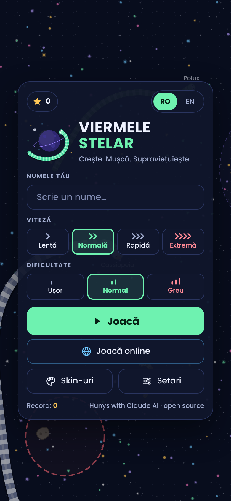
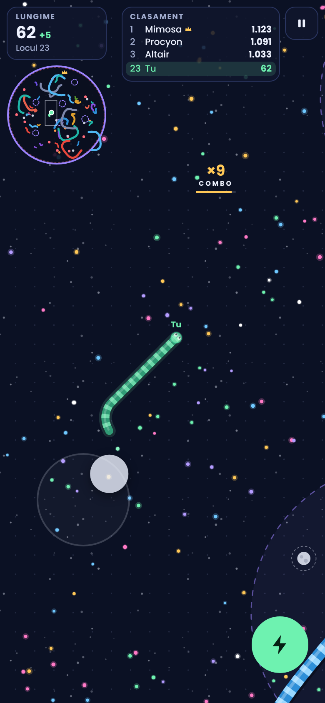
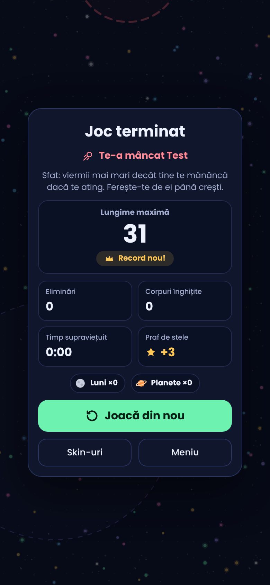
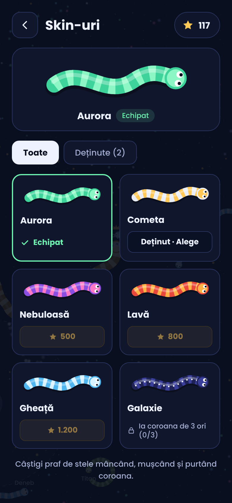
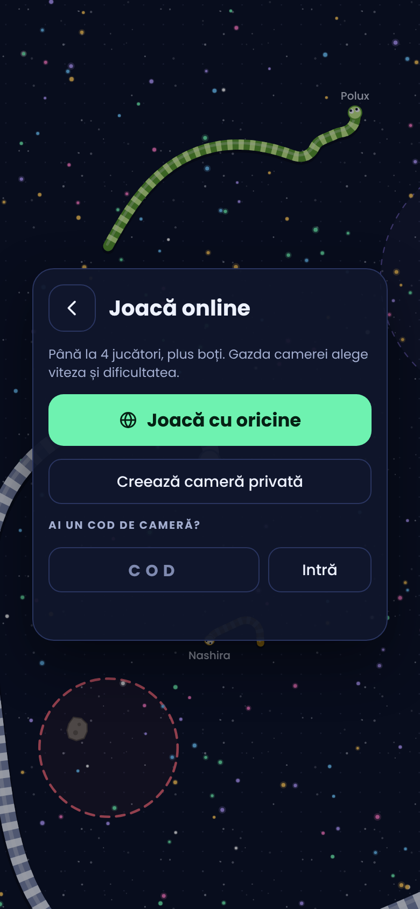

# Viermele Stelar · Star Worm

**Autor / Author:** Hunys with Claude AI · Licență / License: [MIT](../LICENSE)

## Română

Un joc cu viermi în spațiu, pentru telefon și calculator. Mănânci scântei ca să crești, îi muști pe cei mai mici decât tine, porți coroana când ești pe primul loc și eviți meteoriții, găurile negre și marginea arenei.

**Aplicația Android:** descarcă `ViermeleStelar.apk` de la [Releases](https://github.com/cosminpaulet41-beep/Hunys-with-Claude-AI/releases/latest) și instalează-l. Versiunile noi se instalează peste cea veche. APK-ul îl construiește GitHub automat din folderul `android/` de fiecare dată când jocul se schimbă. Merge și pe proiectoare sau televizoare cu Android: săgețile telecomenzii conduc, iar OK dă turbo.

**În browser:** deschide `index.html` în orice browser. Funcționează fără internet, iar fonturile sunt incluse în fișier.

**Online:** butonul „Joacă online” te pune într-o cameră cu până la 4 jucători, plus boți. Poți intra la oricine are o cameră deschisă, poți crea o cameră privată sau poți intra cu un cod de 4 litere. Telefonul gazdei rulează boții și arena, iar viteza și dificultatea sunt cele alese de gazdă. Telefoanele comunică printr-un serviciu public gratuit de mesaje MQTT (HiveMQ, cu EMQX și Mosquitto ca rezervă), deci nu ai nevoie de server propriu. Online merge în aplicație și în `index.html`, dar nu în pagina de previzualizare de pe claude.ai.

**Control**
- Telefon: trage cu degetul în stânga ecranului ca să conduci. Ține apăsat fulgerul pentru turbo.
- Calculator: mouse-ul conduce, iar click sau Space dau turbo. Săgețile sau A/D întorc viermele, iar P sau Esc pun pauză.

**Reguli**
- Când doi viermi se ating, câștigă cel mai mare. Dacă îi prinzi capul unui vierme mai mic, îl mănânci de tot și lasă energie în urmă. Dacă îl muști de corp, îi tai tot ce e de la mușcătură spre coadă: coada se face energie, iar partea dinspre cap trăiește mai departe. La fel ți se poate întâmpla și ție. Pierzi doar dacă îți e mâncat capul sau dacă te lovești cu capul de un vierme mai mare.
- Turbo te costă lungime și merge doar de la lungime 12 în sus.
- Meteoriții se rotesc în cercurile roșii punctate. Când ești pe drumul unuia, apare o țintă roșie.
- Găurile negre te trag spre ele. Dacă ajungi în centru, te aruncă în altă parte a arenei și pierzi 10% din lungime.
- Lunile (de la lungime 25) îți dau Magnet, adică +25% rază de colectare, timp de 30 de secunde. Planetele (de la lungime 60) îți dau un Scut, care te salvează de o lovitură.
- Liderul poartă coroana și primește praf de stele în plus.
- Cu praful de stele cumperi skin-uri. Galaxie se deblochează după ce câștigi coroana de 3 ori.
- Din meniu alegi viteza jocului (Lentă, Normală, Rapidă sau Extremă), dificultatea (Ușor, Normal sau Greu: câți boți sunt, cât de des vânează și cât de repede reacționează) și limba (română sau engleză).

Progresul (praful de stele, recordul și skin-urile) se salvează doar în browserul tău.

## English

A space worm game for phones and computers. Eat sparks to grow, bite worms smaller than you, wear the crown when you lead, and avoid meteors, black holes and the arena edge.

**Android app:** download `ViermeleStelar.apk` from [Releases](https://github.com/cosminpaulet41-beep/Hunys-with-Claude-AI/releases/latest) and install it. New versions install over the old one. GitHub builds the APK automatically from the `android/` folder whenever the game changes. It also runs on Android projectors and TVs: the remote's arrows steer and OK boosts.

**In a browser:** open `index.html` in any browser. It works offline, and the fonts are bundled in the file.

**Online:** “Play online” puts you in a room with up to 4 players, plus bots. You can join anyone with an open room, create a private room, or join with a 4-letter code. The host’s phone runs the bots and the arena, and the host’s speed and difficulty apply. Phones talk through a free public MQTT message service (HiveMQ, with EMQX and Mosquitto as backups), so no server of your own is needed. Online play works in the app and in `index.html`, but not in the claude.ai preview page.

**Controls**
- Phone: drag on the left side of the screen to steer. Hold the lightning button to boost.
- Computer: the mouse steers, and click or Space boosts. Arrow keys or A/D turn, and P or Esc pauses.

**Rules**
- When two worms touch, the bigger one wins. Catch a smaller worm’s head and you eat it whole, leaving its energy behind. Bite its body and you cut off everything from the bite to the tail: the tail turns into energy and the part towards the head lives on. The same can happen to you. You only lose when your head gets eaten or you crash your head into a bigger worm.
- Boosting costs length and needs length 12 or more.
- Meteors circle inside the dashed red rings. A red target appears when you are heading into one.
- Black holes pull you in. Reaching the centre flings you elsewhere and costs 10% of your length.
- Moons (length 25+) give a Magnet: +25% pickup range for 30 seconds. Planets (length 60+) give a Shield that saves you from one hit.
- The leader wears the crown and earns bonus stardust.
- Stardust buys skins. Galaxy unlocks after you win the crown 3 times.
- The menu lets you pick the game speed (Slow, Normal, Fast or Extreme), the difficulty (Easy, Normal or Hard: how many bots there are, how often they hunt and how fast they react) and the language (Romanian or English).

Progress (stardust, best length and skins) is saved only in your browser.
